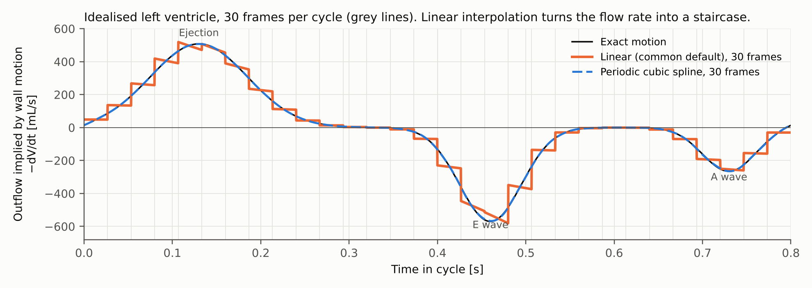
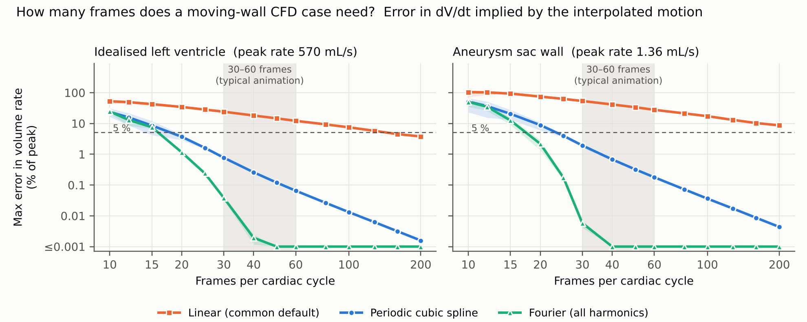
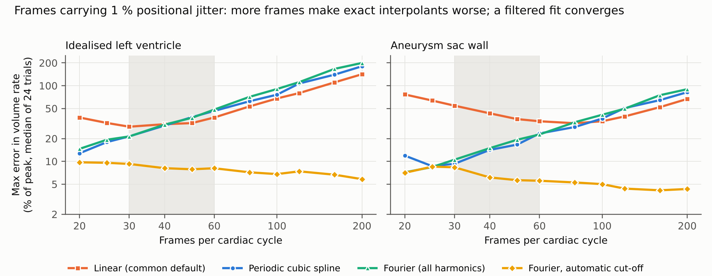
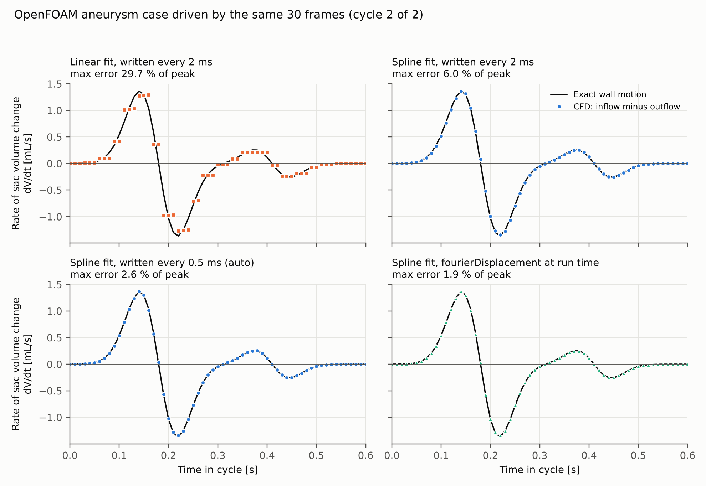

# frames2foam

Drive OpenFOAM moving-boundary simulations from animation or imaging frames, without
quietly corrupting the flow rate.

When wall motion is prescribed from a sequence of frames (an animated heart, segmented
cine MRI, a swimming fish, a morphing wing), the solver needs positions between frames.
Most pipelines interpolate linearly, which is what OpenFOAM's `timeVaryingMappedFixedValue`
does between data samples. Positions are then continuous, but the wall velocity jumps at
every frame. For an incompressible fluid the volume rate of a closed chamber sets the flow
through its openings, so those jumps go straight into the inflow and outflow.

`frames2foam` reads the frames, fits the motion periodically in time, reports whether the
frame rate resolves the motion, and drives OpenFOAM with it in one of two ways. It can write
sampled boundary data for the standard `timeVaryingMappedFixedValue` condition, or Fourier
coefficients for the `fourierDisplacement` condition in this repository, which evaluates the
smooth motion at every solver time step. A Blender script exports frames from FBX, Alembic,
glTF, USD or .blend animations with the vertex correspondence the fit needs.

## What the study shows

The error introduced by temporal interpolation was measured on two reference motions with
known smooth volume rate: an idealised left ventricle following a Wiggers-type volume curve
(EDV 120 mL, stroke volume 69 mL, ejection, E and A waves) and the distending sac of a
fusiform aneurysm. Frames were sampled at 10 to 200 per cycle, at four phase offsets each,
and reconstructed with each method in the tool.

| Max error in volume rate, % of peak | LV, 30 frames | LV, 60 frames | Aneurysm, 30 frames | Aneurysm, 60 frames |
|---|---|---|---|---|
| Linear | 24 | 12 | 54 | 28 |
| Periodic cubic spline | 0.8 | 0.07 | 1.9 | 0.18 |
| Fourier (all harmonics) | 0.04 | < 0.001 | 0.006 | < 0.001 |

With linear interpolation the LV case needs about 160 frames per cycle to bring the error
below 5 %, and the aneurysm case does not get there by 200. A periodic spline gets there
with 20 to 25 frames. The peak rate itself is reproduced reasonably by linear interpolation
(within 1 to 6 % at 30 frames); the damage is in the shape of the waveform, which is a sequence of steps
with a jump at every frame.

Real frames carry jitter, from mesh export, segmentation or rigging. Velocity is a time
derivative, so jitter is amplified as frames get closer together. With 1 % positional noise,
every interpolant that passes exactly through the frames gets worse as frames are added.
The Fourier fit with automatic cut-off (`--method fourier --nharm auto`) estimates the noise
floor from the frame spectrum, keeps only the harmonics above it, and converges instead.

## CFD confirmation

The fusiform aneurysm case (pimpleFoam, `displacementLaplacian` mesh motion, 75k cells) was run
three times from the same 30 OBJ frames. The realised volume rate, inflow minus outflow,
follows the written motion in every run, so the interpolation error passes straight into the flow.

| Run (same 30 frames) | Motion given to OpenFOAM | Stored data | CFD vs exact motion | CFD vs fit |
|---|---|---|---|---|
| Linear | samples every 2 ms | 99 MB | 29.7 % | 7.9 % |
| Periodic spline | samples every 2 ms | 89 MB | 6.0 % | 4.4 % |
| Periodic spline | samples every 0.5 ms (`--dt auto --rate-tol 1.2`) | 333 MB | 2.6 % | 0.8 % |
| Periodic spline | `fourierDisplacement`, 41 harmonics | 8.7 MB | 1.9 % | 0.4 % |

Errors are the maximum over the second cycle in % of peak dV/dt, from inflow minus outflow
at the 80 written time steps per cycle. These instants do not always fall on the frame-to-frame
jumps of the linear run, so its true worst case (54 % in the study) is under-sampled here. The
error left in the last two runs is mostly the spline itself, because 30 frames do not fully
resolve this waveform (1.9 % in the study). The first three runs used OpenFOAM v1912 with the
standard `timeVaryingMappedFixedValue` condition, the last used v2512.

The middle run exposed a second, less obvious error source. OpenFOAM interpolates boundary
data linearly between the written samples, so a smooth fit written every 2 ms is again a
staircase, just a finer one. For this sharp systolic waveform that alone costs about 4.5 %
of peak. `frames2foam` therefore estimates the error of the written samples for a range of
output intervals and, with `--dt auto`, picks the coarsest one that meets `--rate-tol`. Its
estimate for 2 ms (4.6 %) matched the CFD (4.4 % against the fitted motion).

## Smooth motion at run time

The written-sample error above comes from OpenFOAM's linear interpolation between stored
samples. The `fourierDisplacement` boundary condition (in `openfoam/`, built with `wmake libso`)
removes it by evaluating the Fourier series of the fitted motion at every time step:

    frames2foam write "frames/heart_*.obj" --period 0.8 --case . --patch wall \
        --method spline --format fourier

In the aneurysm case this gave the best result of the four runs (table above) with the
smallest data, 8.7 MB of coefficients against 333 MB of samples, written in 6 seconds. The
wall displacement applied by the solver matched the Python spline fit to 0.006 % of the
displacement amplitude, and a two-processor run applied exactly the same wall motion as the
serial run.

See `openfoam/README.md` for the case setup, and `examples/aneurysm` for a complete case
(`./Allrun` builds the mesh, writes the frames and coefficients, and runs pimpleFoam). Points are matched by position at start-up, so
the same coefficient file works in decomposed parallel runs.

## From an animation file

`tools/blender_export_frames.py` runs inside Blender and writes one OBJ per frame with the
vertex order kept, after evaluating shape keys, armatures and modifiers:

    blender -b --python tools/blender_export_frames.py -- \
        --input heart.fbx --objects LV RV --out frames/ --scale 0.01

It reads .fbx, .abc, .glb/.gltf, .usd and .blend, takes the frame range from the animation,
and stops with an error if a modifier changes the mesh topology between frames. It also writes
a `manifest.json` with the frame rate and the suggested period. A frame that repeats the first
one at the end of a loop is dropped automatically by `frames2foam`. Tested with Blender 4.0 on
an animated chamber exported to FBX and re-imported (vertex positions identical to the .blend
export within 1e-7 of the model size). The Ubuntu build of Blender used for testing has no
Alembic support, so the .abc path is untested here; official Blender builds include it.

## Install

    pip install git+https://github.com/sgoudarzi/frames2foam

Requires Python 3.9 or newer, numpy and scipy. OpenFOAM is only needed to run the case
(the `fourierDisplacement` condition is tested with v2512; the mapped-data runs used v1912),
and Blender only for exporting frames from animation files.

## Use

Frames must share vertex count and ordering (vertex correspondence), which animation exports
and most cine segmentation tools provide. Frame files are sorted naturally, so `f_2.obj` comes
before `f_10.obj`. If the last frame repeats the first it is dropped automatically.

Check whether the frame rate resolves the motion. The tool compares the volume rate implied by
the three fits; if the smooth fits disagree, the motion is under-resolved in time. It also
reports the error of the written samples against the number of samples per cycle.

    frames2foam check "frames/heart_*.obj" --period 0.8 --scale 0.001

Write boundary data for a patch of an existing case whose mesh was built from frame 0:

    frames2foam write "frames/heart_*.obj" --period 0.8 --scale 0.001 \
        --case myCase --patch wall --method spline --dt auto --rate-tol 1 --cycles 3

Use `--method fourier --nharm auto` for noisy frames. Patch points are attached to the frame
surface by closest-point projection with barycentric weights, so the CFD mesh does not have
to share vertices with the frames. `--max-map-distance` stops the run if the mesh and the
frames do not line up (wrong units or wrong reference frame). The polyMesh must be ASCII;
convert with `foamFormatConvert` if needed.

In the case, the patch reads the data with

    wall
    {
        type            timeVaryingMappedFixedValue;
        mapMethod       nearest;
        offset          (0 0 0);
        setAverage      false;
        value           uniform (0 0 0);
    }

in `0/pointDisplacement`, together with a displacement-based motion solver in
`constant/dynamicMeshDict`. Fine output sampling has a cost in disk space (about 100 kB per
sample for 6,000 patch points), so `--dt auto` stops at the coarsest interval that meets the
tolerance.

From Python:

    from frames2foam import read_frames, PeriodicMotion
    X, tri, files = read_frames("frames/heart_*.obj", scale=1e-3)
    motion = PeriodicMotion(X, period=0.8, method="fourier", nharm="auto")
    x, u = motion.position(0.31), motion.velocity(0.31)

## Reproduce the study

    cd study
    python3 run_study.py      # convergence with frame count
    python3 run_noise.py      # robustness to frame jitter
    python3 figures.py

Both reference motions are separable, X(t) = base + f(t) shape, and all three interpolants
are linear in the data, so the study interpolates f(t) through `PeriodicMotion` and rebuilds
the surface flux exactly; `run_study.py` checks this against full vertex-by-vertex
interpolation (agreement to round-off). `make_frames.py` writes the 30 OBJ frames used for
the CFD runs, and `cfd_compare.py` post-processes them. The OpenFOAM case itself is the
fusiform aneurysm case with its wall data replaced by `frames2foam write`.

## Repository layout

    frames2foam/                 Python package (fitting, checks, OpenFOAM writers, CLI)
    openfoam/fourierDisplacement OpenFOAM boundary condition for run-time Fourier motion
    tools/                       Blender script that exports animation frames
    examples/aneurysm            complete OpenFOAM case driven by 30 frames
    study/                       frame-rate study, noise study, CFD comparison, figures
    tests/                       unit tests (pytest)

## Scope and limits

The reference motions are idealised and chosen to have a known exact volume rate. The method
assumes periodic motion and consistent vertex correspondence between frames. Valve leaflets
that close to contact change the topology of the fluid domain and need a separate treatment
(for example a penalisation zone); the tool handles the moving walls around them.

## Author

Sahar Goudarzi, PhD, CFD engineer.
[Google Scholar](https://scholar.google.com/citations?user=1Sy7n3cAAAAJ)

Not affiliated with or endorsed by OpenCFD Ltd, owner of the OPENFOAM trademark.
